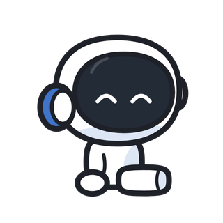
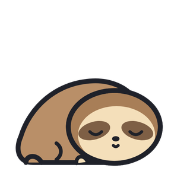
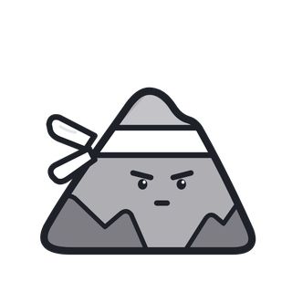

# Focus Crew

A native iOS focus timer and Screen Time app blocker, starring five tiny companions: **Orbit**, **Spark**, **Leaf**, **Pebble** and **Blob**. It also comes with a macOS menu bar app that shows your session right next to the MacBook notch.

<p align="center">
      
</p>

| Companion | Role | Trait |
|---|---|---|
| Orbit | The Focus Companion | Focus |
| Spark | The Motivation Boost | Energy |
| Leaf | The Rest Guardian | Recovery |
| Pebble | The Discipline Coach | Habits |
| Blob | The Progress Tracker | Progress |

## Try it in a browser

`docs/preview/` is a playable web version of the app (onboarding, companion match, timer, simulated blocking, schedules, insights, crew). With GitHub Pages on, it's at https://tomasbeja2007.github.io/focus-mascots/preview/. Blocking, notifications and widgets are simulated there; the iPhone app does them for real.

## What's inside

**iPhone app (SwiftUI, iOS 17+)**
- **Onboarding (24 screens):** welcome, 3 intro pages, name, **9 questions** (age, role, daily screen time, struggles, time sinks, hardest times, focus span, goal, motivation style), a "years on your phone" reality check, an animated analysis, the companion reveal (or pick another), a personal plan, a daily goal, Screen Time permission, app picker, notifications, a hold-to-commit pledge, then a membership screen that says **everything is free**.
- **Focus:** a timer with presets, an intention, strict mode, a block list and ambient sounds generated live (brown, pink and white noise, rain, ocean). A full-screen session view with the mascot inside a progress ring, rotating encouragement, pause and resume, and a 5-second hold to give up in strict mode. A celebration screen with confetti, bond XP, streaks and new badges, then an optional break timer.
- **Blocking (Apple Screen Time):** FamilyControls authorization, FamilyActivityPicker, ManagedSettings shields for focus sessions, DeviceActivity schedules that keep working while the app is closed, strict mode that also blocks app deletion, and a custom shield screen with your mascot.
- **Blocks tab:** the focus block list and recurring schedules (templates: Work, Study, Bedtime, Morning, Dinner), with weekdays, overnight ranges and a guardian mascot.
- **Insights:** week/month chart with a goal line, totals, streaks, completion rate, a "when you focus" heat strip, a real Screen Time report (top apps, pickups) and recent sessions.
- **Crew:** companion card with bond level, all five mascots with seven expressions each, and 16 badges.
- **Settings:** goals, durations, strict default, pauses, Live Activity, blocking, sounds, haptics, appearance, notifications (session alerts, daily reminder, streak saver), Mac sync, widgets help, retake the quiz, rate, share, support, privacy, terms, reset.
- **System integration:** Live Activity on the Lock Screen and Dynamic Island (with pause and end buttons), Home Screen widgets (small, medium, large), Lock Screen widgets (circular, rectangular, inline), a Control Center "Start Focus" button (iOS 18+), Siri and Shortcuts phrases, deep links (`focuscrew://start?minutes=25`) and local notifications with a custom chime.

**Mac companion (SwiftUI + AppKit, macOS 14+)**
- A menu bar timer, plus a black "ear" next to the notch with your mascot and a live countdown. Click it to expand and see details, pause or end. Macs without a notch get a floating pill instead.
- Picks up the iPhone's running session through iCloud key-value storage, and can run its own sessions.
- Plays a celebration chime when a session ends, and can open at login.

**Monetisation:** free for now. `App/Services/PurchaseManager.swift` already implements StoreKit 2 (products, purchase, restore, entitlements). Set `Monetization.paywallEnabled = true` and create the three products to start charging. `App/Resources/FocusCrew.storekit` lets you test purchases locally.

## Project layout

```
App/            iPhone app (onboarding, home, session, blocks, insights, crew, settings, services)
Widgets/        WidgetKit extension: widgets, Live Activity, Control Center button
Monitor/        DeviceActivity monitor extension (schedules, session end)
Shield/         Custom shield screen for blocked apps
ShieldAction/   Shield button handling
Report/         Screen Time usage report (DeviceActivityReport extension)
Mac/            macOS menu bar + notch companion
Shared/Core     Models, stats, persistence (App Group JSON), used by every target
Shared/UI       Theme + animated MascotView (iOS and macOS)
SharedIOS/      Screen Time helpers, Live Activity types and intents, widget views
design/         Mascot vector source (Python to SVG to PNG), colour tokens, sounds
docs/           Privacy policy, terms, support pages, App Store kit
ci/             Screens captured by CI
```

The mascot art is generated from code in `design/mascots/generate.py` (seven expressions per mascot, plus avatars and app icons). Re-render with `python3 design/mascots/generate.py && node design/mascots/render.mjs`.

## Run it

1. Open `FocusCrew.xcodeproj` in Xcode 26 or later.
2. In `Configs/Shared.xcconfig`, set `DEVELOPMENT_TEAM` to your Team ID. If needed, change the bundle IDs and App Group to a domain you own.
3. Pick the **FocusCrew** scheme and run it on a real iPhone. Screen Time blocking doesn't work in the Simulator; everything else does.
4. For the Mac app, run the **FocusCrewMac** scheme.

Changed `project.yml`? Regenerate the project with `brew install xcodegen && xcodegen generate`.

To preview any screen with sample data in a Debug build, add `-demoScreen home` (or any name in `ci/screens.txt`) as a launch argument.

## Before the App Store

See [`docs/APP_STORE.md`](docs/APP_STORE.md) for the full listing (description, keywords, privacy label, review notes) and checklist. The short version:

1. Request the **Family Controls (Distribution)** entitlement from Apple for the app and all four Screen Time extensions. Development builds work without it.
2. Turn on GitHub Pages (`main` branch, `/docs` folder) so the privacy and support URLs work, or host those pages elsewhere and update `Monetization.privacyURL` and `supportURL`.
3. Replace `support@focuscrew.app` in `PurchaseManager.swift` with your real support address.
4. Archive and upload.

## Tests

`Tests/CoreTests` holds 29 XCTest cases for the shared logic: mascot matching, streaks, bond levels, achievements, overnight schedules, pause and resume maths, and decoding of older data files. Run them with the **FocusCrewCoreTests** scheme (it runs on macOS, so no simulator is needed).

## CI

`.github/workflows/build.yml` runs on every push:
- builds the iOS app and all extensions for the Simulator (Debug) and for devices (Release, unsigned)
- builds the Mac app and runs the unit tests
- launches the app in an iPhone 17 Pro simulator, screenshots every screen in `ci/screens.txt` (light and some dark), and publishes them to the `ci-screenshots` branch
- when run manually with **appstore** ticked (Actions › Build › Run workflow), it also captures the 6.9" App Store set listed in `ci/appstore-screens.txt`

## App Store screenshots

`docs/appstore/` holds ready-to-upload 1320 × 2868 screenshots (captioned, with the crew). To regenerate them from a fresh CI capture:

```bash
node design/appstore/frame.mjs <folder with the raw 6.9" captures> docs/appstore
```
